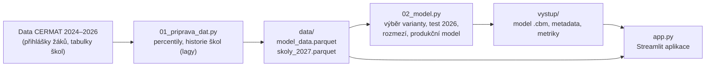

# Odhad šance na přijetí na střední školu

Model strojového učení a webová aplikace, které z bodů z jednotné přijímací zkoušky (ČJ + matematika)
odhadnou šanci na přijetí na konkrétní obor střední školy. Postavené na reálných datech CERMAT
z 1. kola přijímacího řízení 2024–2026, predikce pro rok 2027.

**Aplikace:** https://prijimackysance.streamlit.app/

Uživatel vybere kraj, typ školy a obor, zadá body a uvidí:

- odhad šance na přijetí (při podání přihlášky na 1. místo),
- **rozmezí šance** podle toho, jak se laťka přijetí školy mezi roky posouvá,
- kolik bodů mu chybí na šanci 90 %,
- historii školy: průměr přijatých a laťku přijetí v letech 2024–2026,
- v režimu přehledu tabulku všech škol v kraji seřazenou podle šance.

## Výsledky

Model trénovaný jen na roce 2025, jednou otestovaný na roce 2026 (priorita 1, n = 104 637 přihlášek):

| Model | AUC | Brier | LogLoss | ECE |
|---|---|---|---|---|
| Benchmark: percentil žáka vs. loňská laťka + logistická regrese | 0,937 | 0,099 | 0,319 | 0,025 |
| **CatBoost s monotónními omezeními** | **0,950** | **0,087** | **0,280** | **0,015** |

- Model je dobře kalibrovaný i bez dodatečné kalibrace: když řekne 70 %, uspěje zhruba 7 z 10 takových uchazečů
  (`vystup/kalibrace_2026_priorita1.csv`).
- Křížová validace na 2025 (AUC 0,942) odpovídá testu na 2026 (0,950), takže validace není přehnaně optimistická.
- Rozmezí šance (nominálně 80 %) pokrylo skutečnou úspěšnost oboru v roce 2026 u **82 %** z 1 191 oborů.

## Jak to funguje



**Příznaky (features)**

- **Žák:** percentil (pořadí mezi uchazeči stejného roku a ročníku) v součtu i v ČJ a M zvlášť.
  Percentil nezávisí na obtížnosti testu, která se mezi roky mění. Páťáci a sedmáci (víceletá gymnázia)
  píšou jiné testy, proto mají vlastní percentil.
- **Škola:** historie oboru z minulých let, tedy zájem, převis a percentily přijatých (minimum,
  10. percentil, medián). Rok X vidí jen roky X−1 a X−2, aby nedošlo k úniku informací (data leakage).
- **Rozdíl žák − škola:** o kolik je žák nad laťkou přijetí z minulých let.

**Model:** CatBoost (gradient boosting nad rozhodovacími stromy) s **monotónními omezeními**.
Víc bodů nikdy nesníží šanci, a proto lze spolehlivě spočítat, kolik bodů chybí.

**Validace:**

- časové dělení (trénink 2025, test 2026),
- výběr varianty křížovou validací `GroupKFold` po oborech škol, aby validace neprozradila letošní laťku školy,
- test 2026 se použil jen jednou.

**Laťka přijetí a rozmezí šance**

Laťka přijetí je počet bodů, nad kterým bylo 9 z 10 přijatých. Mezi roky se posouvá podle toho,
kolik silných uchazečů se zrovna přihlásí. Rozmezí šance je šance žáka, kdyby se laťka posunula nahoru
nebo dolů o `delta`. Posun se měří v z-skóre pořadí, `delta = max(běžné kolísání, kolísání školy)` a běžné
kolísání je 80% kvantil posunů laťky mezi roky.

Když má žák víc bodů než laťka všech minulých let i než horní odhad laťky, aplikace ukáže
„šanci minimálně X %“. 100 % neukazuje nikdy.

## Omezení

- U elitních gymnázií se laťka mezi roky posouvá až o 10–20 bodů. Takové skoky z historie předpovědět
  nejde, rozmezí na ně ale upozorní.
- Body se převádějí na percentil podle rozložení roku 2026. Aplikace předpokládá, že test 2027 bude stejně těžký.
- Model nezná školní kritéria (prospěch, školní nebo talentová zkouška) ani pořadí ostatních přihlášek uchazeče.
- U priorit 2–5 je cíl optimistický, protože přijetí na vyšší prioritu se počítá jako úspěch. Aplikace proto
  ukazuje šanci pro školu na 1. místě.

## Struktura repozitáře

```
github/
  01_priprava_dat.py   # Excel CERMAT -> data/ (percentily, historie škol, převodní tabulky)
  02_model.py          # výběr varianty, test 2026, rozmezí šance, produkční model -> vystup/
  app.py               # Streamlit aplikace
  test_app.py          # automatický test aplikace (18 škol, 110 kombinací bodů)
data/                  # příznaky škol pro rok 2027, převod bodů na percentil, názvy škol
vystup/                # natrénované modely, metadata.json, metriky z testu 2026
requirements.txt
```

## Spuštění

```bash
pip install -r requirements.txt
streamlit run github/app.py        # aplikace (model a data jsou v repozitáři)
python github/test_app.py          # test aplikace
```

Přetrénování od začátku potřebuje data CERMAT, která v repozitáři nejsou. Soubory
`PZ{rok}_kolo1_*.xlsx` a `skoly_2027.csv` patří do složky `../DATA` vedle repozitáře
(nebo nastav proměnnou `PRIJIMACKY_ROOT`):

```bash
python github/01_priprava_dat.py   # cca 2 min
python github/02_model.py          # cca 15–30 min
```

## Data

Výsledky jednotné přijímací zkoušky, CERMAT (1. kolo, denní studium, roky 2024–2026).
Repozitář obsahuje jen odvozené souhrny za školy a obory, žádná data jednotlivých uchazečů.

## Technologie

Python · pandas · CatBoost · scikit-learn · SciPy · Streamlit · Plotly
