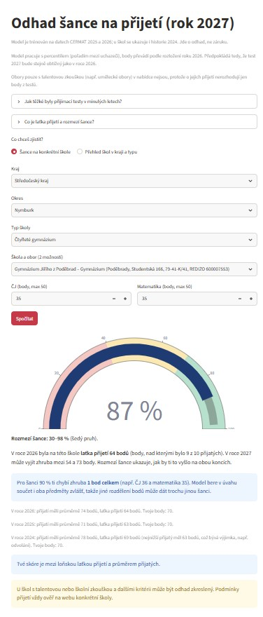

# Odhad šance na přijetí na střední školu

Model strojového učení a webová aplikace, které z bodů z jednotné přijímací zkoušky (ČJ + matematika)
odhadnou šanci na přijetí na konkrétní obor střední školy. Postavené na reálných datech CERMAT
z 1. kola přijímacího řízení 2024–2026, predikce pro rok 2027.

**Aplikace:** https://prijimackysance.streamlit.app/

*In English: an ML model (CatBoost with monotonic constraints) and a Streamlit app that estimate the probability
of admission to a Czech secondary school from national entrance-exam scores, trained on official CERMAT data 2024–2026.*



## Co aplikace ukáže

Uživatel vybere kraj, typ školy a obor, zadá body a uvidí:

- odhad šance na přijetí (při podání přihlášky na 1. místo),
- **rozmezí šance** podle toho, jak se laťka přijetí školy mezi roky posouvá,
- kolik bodů mu chybí na šanci 90 %,
- historii školy: průměr přijatých a laťku přijetí v letech 2024–2026,
- v režimu přehledu tabulku všech škol v kraji seřazenou podle šance.

## Výsledky

Model trénovaný jen na roce 2025, jednou otestovaný na roce 2026 (priorita 1, n = 104 637 přihlášek):

| Model | AUC | Brier | LogLoss | ECE |
|---|---|---|---|---|
| Benchmark: percentil žáka vs. loňská laťka + logistická regrese | 0,937 | 0,099 | 0,319 | 0,025 |
| **CatBoost s monotónními omezeními** | **0,950** | **0,087** | **0,280** | **0,015** |

- Model je dobře kalibrovaný i bez dodatečné kalibrace: když řekne 70 %, uspěje zhruba 7 z 10 takových uchazečů.
- Křížová validace na 2025 (AUC 0,942) odpovídá testu na 2026 (0,950), takže validace není přehnaně optimistická.
- Rozmezí šance (nominálně 80 %) pokrylo skutečnou úspěšnost oboru v roce 2026 u **82 %** z 1 191 oborů.

## Jak to funguje (stručně)

- **Žák** je popsaný percentilem (pořadím mezi uchazeči stejného roku a ročníku), ne body, protože obtížnost testu
  se mezi roky mění.
- **Škola** je popsaná historií z minulých let (laťka přijetí, převis, zájem). Rok X vidí jen roky X−1 a X−2,
  aby nedošlo k úniku informací (data leakage).
- **Model:** CatBoost s monotónními omezeními, takže víc bodů nikdy nesníží šanci.
- **Validace:** trénink 2025, jediný test 2026, výběr varianty křížovou validací `GroupKFold` po oborech.

Architektura, datová pipeline, metriky, metoda rozmezí šance a omezení modelu jsou podrobně popsané
v **[technické dokumentaci](docs/dokumentace.md)**.

## Hlavní omezení

- U elitních gymnázií se laťka mezi roky posouvá až o 10–20 bodů; rozmezí šance na to upozorní.
- Aplikace předpokládá, že test 2027 bude stejně těžký jako v roce 2026.
- Model nezná školní kritéria (prospěch, školní nebo talentová zkouška).

## Struktura repozitáře

```
github/
  01_priprava_dat.py   # Excel CERMAT -> data/ (percentily, historie škol, převodní tabulky)
  02_model.py          # výběr varianty, test 2026, rozmezí šance, produkční model -> vystup/
  app.py               # Streamlit aplikace
  test_app.py          # automatický test aplikace (23 oborů škol, 110 kombinací bodů)
data/                  # příznaky škol pro rok 2027, převod bodů na percentil, názvy škol
vystup/                # natrénované modely, metadata.json, metriky z testu 2026
docs/                  # technická dokumentace a obrázky
requirements.txt
```

## Spuštění

```bash
pip install -r requirements.txt
streamlit run github/app.py        # aplikace (model a data jsou v repozitáři)
python github/test_app.py          # test aplikace
```

Přetrénování od začátku potřebuje data CERMAT, která v repozitáři nejsou. Soubory
`PZ{rok}_kolo1_*.xlsx` a `skoly_2027.csv` patří do složky `../DATA` vedle repozitáře
(nebo nastav proměnnou `PRIJIMACKY_ROOT`):

```bash
python github/01_priprava_dat.py   # cca 2 min
python github/02_model.py          # cca 15–30 min
```

## Data

Výsledky jednotné přijímací zkoušky, CERMAT (1. kolo, denní studium, roky 2024–2026).
Repozitář obsahuje jen odvozené souhrny za školy a obory, žádná data jednotlivých uchazečů.

## Technologie

Python · pandas · CatBoost · scikit-learn · SciPy · Streamlit · Plotly
