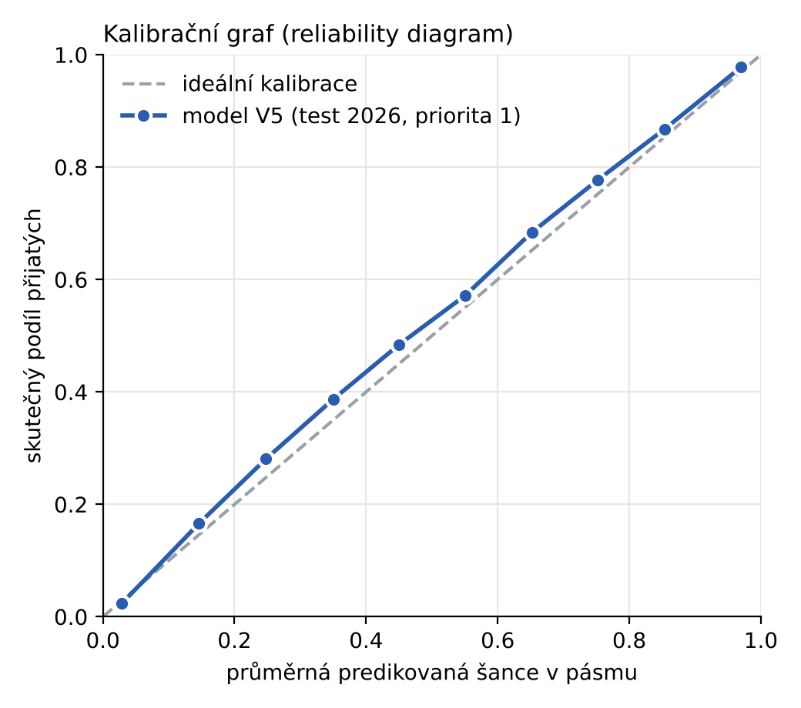
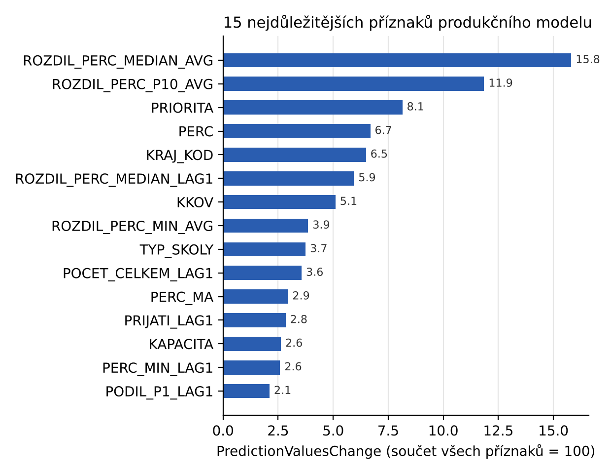

# Technická dokumentace – odhad šance na přijetí na SŠ (model V5)

Podrobný popis toho, co projekt počítá a proč. Stručný přehled je v [README](../README.md),
aplikace běží na <https://prijimackysance.streamlit.app/>.

## Obsah

1. [Projekt v kostce](#projekt-v-kostce)
2. [Architektura](#architektura)
3. [Data a jejich příprava](#data-a-jejich-příprava-01_priprava_datpy)
4. [Modelování](#modelování-02_modelpy)
5. [Metriky](#metriky-co-měří-a-jak-je-číst)
6. [Rozmezí šance](#rozmezí-šance)
7. [Aplikace a její testování](#aplikace-a-její-testování)
8. [Vývoj modelu V0 → V5](#vývoj-modelu-v0--v5)
9. [Omezení a možná vylepšení](#omezení-a-možná-vylepšení)
10. [Slovníček](#slovníček)

## Projekt v kostce

**Otázka:** Jaká je šance, že uchazeč s danými body z jednotné přijímací zkoušky (ČJ a matematika, každá max. 50 bodů) bude přijat na konkrétní obor střední školy, když ho napíše na 1. místo přihlášky?

**Data:** CERMAT, 1. kolo přijímacího řízení 2024, 2025 a 2026, denní studium. Jeden řádek = jedna přihláška (žák × škola × obor).

**Výstup:** pravděpodobnost přijetí (bodový odhad), rozmezí šance, počet chybějících bodů na šanci 90 % a historie školy, vše ve Streamlit aplikaci <https://prijimackysance.streamlit.app/>.

**Hlavní výsledek** (model natrénovaný jen na roce 2025, jednou otestovaný na roce 2026, priorita 1):

| Model | n | AUC | Brier | LogLoss | ECE |
|---|---:|---:|---:|---:|---:|
| Benchmark: logistická regrese na rozdílu od loňské laťky | 102 413 | 0,937 | 0,099 | 0,319 | 0,025 |
| **CatBoost V5 s monotónními omezeními** | 104 637 | **0,950** | **0,087** | **0,280** | **0,015** |

Rozmezí šance (nominálně 80 %) pokrylo skutečnou úspěšnost 82 % z 1 191 oborů v roce 2026.

**Pět rozhodnutí, která model dělají tím, čím je:**

1. Žák je popsaný **percentilem** (pořadím), ne body, protože obtížnost testu se mezi roky mění.
2. Škola je popsaná **historií z minulých let (lagy)**, nikdy statistikami téhož roku (ochrana proti data leakage).
3. **CatBoost s monotónními omezeními:** víc bodů nikdy nesníží šanci.
4. **Poctivá validace:** časové dělení a `GroupKFold` po oborech; test 2026 použitý jen jednou.
5. **Rozmezí šance** podle toho, jak se laťka školy mezi roky posouvá, ověřené pokrytím na roce 2026.

## Architektura

### Tři kroky, tři skripty

| Krok | Skript | Vstup | Výstup |
|---|---|---|---|
| 1. Příprava dat | `01_priprava_dat.py` | Excely CERMAT ve složce `DATA` | `data/model_data.parquet` (trénink), `data/skoly_2027.parquet` (příznaky škol pro 2027), `data/tabulky_percentilu_2026.csv` (převod bodů na percentil), `data/skoly_2027_nazvy.csv` (názvy a adresy) |
| 2. Model | `02_model.py` | `data/model_data.parquet`, `data/skoly_2027.parquet` | `vystup/validacni_2025.cbm`, `vystup/produkce_2025_2026.cbm`, `vystup/metadata.json`, metriky (`test_2026.csv`, `vyber_oof_2025.csv`, `kalibrace_2026_priorita1.csv`, `rozmezi_pokryti_2026.csv`, `dulezitost_priznaku.csv`) |
| 3. Aplikace | `app.py` | `data/`, `vystup/` | webová aplikace |
| Test | `test_app.py` | `app.py` | `test_vysledky.csv` (23 oborů, 110 kombinací bodů) |

**Proč samostatné skripty a soubory mezi nimi:** každý krok jde spustit znovu bez ostatních (přetrénování modelu nevyžaduje 2 minuty čtení Excelů, úprava aplikace nevyžaduje přetrénování). Formát **Parquet** zachová datové typy (např. REDIZO jako text, ne číslo), je asi 7× menší než CSV a načte se mnohem rychleji.

**Proč `metadata.json`:** aplikace z něj bere seznam příznaků, jejich pořadí, kategorie a šířku rozmezí (`delta`). Kdyby byl seznam příznaků napsaný ručně ve dvou souborech, stačí jedna změna v tréninku a aplikace by tiše posílala modelu špatné sloupce. Tomu se v praxi říká **training–serving skew** (rozdíl mezi tréninkem a nasazením) a metadata ho brání.

### Dva modely: validační a produkční

| Model | Trénink | K čemu |
|---|---|---|
| `validacni_2025.cbm` | jen 2025 | jediné vyhodnocení na roce 2026, ověření rozmezí šance |
| `produkce_2025_2026.cbm` | 2025 + 2026 | běží v aplikaci, predikuje rok 2027 |

Postup se jmenuje **refit on all data**: nastavení (varianta, počet stromů) se vybere a ověří na validačním modelu, pak se stejné nastavení natrénuje na všech datech. Produkční model už nemá vlastní nezávislý test, jeho kvalitu odhadujeme výsledkem validačního modelu. Rok 2026 je nejbližší roku 2027, a proto by bylo škoda ho do tréninku nedat.

### Co se děje v aplikaci po kliknutí na „Spočítat“

1. **Body → percentil.** Body z ČJ a M (0–50) se převedou na % skóre (×2) a pak přes převodní tabulku roku 2026 na percentil v kohortě (9., 7. nebo 5. třída podle typu školy). Mezi body tabulky se dopočítává lineární interpolací (`np.interp`).
2. **Příznaky.** K řádku školy (historie z `skoly_2027.parquet`) se doplní percentily žáka, priorita = 1 a rozdíly `ROZDIL_* = PERC − laťka školy`.
3. **Bodový odhad.** `model.predict_proba` → šance.
4. **Rozmezí.** Totéž pro pořadí žáka posunuté o −`delta` a +`delta` (oddíl „Rozmezí šance“).
5. **Kolik bodů chybí.** Jedna dávka predikcí pro +1, +2, … bodů (střídavě do ČJ a M); první, která dosáhne 90 %. Že je první zásah opravdu minimum, zaručuje monotónnost modelu.
6. **Texty.** Laťka přijetí v bodech, historie 2024–2026, upozornění (talentová zkouška, málo přijatých, jen 1 rok historie, víceletá gymnázia).

Streamlit spouští při každé akci uživatele celý skript znovu. Model a tabulky se proto načítají funkcí s `@st.cache_resource`, která proběhne jen jednou za běh serveru.

## Data a jejich příprava (01_priprava_dat.py)

### Filtry

| Filtr | Proč |
|---|---|
| denní studium (`den`, `den2`), nezkrácené | jiné formy mají jiný režim přijímání |
| bez nástaveb (`/51`, `/52`) | nástavby jsou pro absolventy SŠ, ne pro žáky ZŠ |
| jen obory s povinnou jednotnou zkouškou (`POVINNOST_JPZ = 1`) | kde není test, nerozhoduje o přijetí |
| jen žáci, kteří napsali oba testy | bez bodů nemáme vstup |
| jen známý stav přihlášky | neznámý stav nejde převést na cíl |

### Široký → dlouhý formát

V Excelu je jeden řádek = jeden žák se sloupci `ss1_*` až `ss5_*` pro pět priorit. Model ale odhaduje šanci na **konkrétní** škole, takže potřebuje jeden řádek = jednu přihlášku. Převod dělá cyklus přes priority a `pd.concat`.

### Cíl: SPLNIL_KRITERIA

| Stav přihlášky | Cíl | Komentář |
|---|:---:|---|
| přijat | 1 | |
| přijat na vyšší prioritu | 1 | předpoklad, ne fakt |
| vzdal se přijetí | 1 | byl přijat, pak odmítl |
| nepřijat (kapacita, nesplnění podmínek) | 0 | |

**Proč „přijat na vyšší prioritu“ = 1 a proč je to problém:** systém přijme žáka na nejvyšší prioritu, na kterou dosáhne, a na nižších prioritách už se nevyhodnocuje. Nevíme tedy, jestli by na prioritě 2 uspěl. Tomu se ve statistice říká **cenzurovaná data**: skutečnou hodnotu nevidíme, jen víme, že ji zakrylo jiné rozhodnutí. Hodnota 1 je optimistický předpoklad.

**Jak se s tím projekt vyrovnává:** na prioritě 1 problém není (vyšší priorita neexistuje). Model se proto hodnotí hlavně na prioritě 1 a aplikace ukazuje šanci pro školu na 1. místě. Alternativní cíl `NAD_HRANICI` (žák je nad nejslabším přijatým téhož roku) byl vyzkoušený jako varianty C a D, ale na OOF 2025 nebyl lepší (LogLoss 0,3062 a 0,3037 proti 0,3029).

### Kohorty: páťáci, sedmáci, deváťáci

Na osmiletá gymnázia (obory `K/81`) se hlásí páťáci, na šestiletá (`K/61`) sedmáci. Píšou **jiné testy** než deváťáci, takže jejich body nejsou srovnatelné. Kohortu CERMAT přímo neuvádí, odvozuje se z přihlášek: kdo se hlásí jen na `K/81`, je páťák; jen na `K/61`, sedmák; jinak deváťák. Percentil se pak počítá zvlášť pro každý rok a kohortu.

### Percentil žáka

**Co se počítá:**
> **PERC = 100 · (pořadí žáka podle bodů v roce a kohortě) / (počet žáků v roce a kohortě)**
v pandas `groupby(["ROK", "KOHORTA"])["SKOR_CJ_MA"].rank(pct=True) * 100`. Shody dostanou průměrné pořadí, takže dva žáci se stejnými body mají stejný percentil. Počítá se pro součet (`PERC`) i pro ČJ (`PERC_CJ`) a M (`PERC_MA`) zvlášť.

**Proč ne body:**

- Obtížnost testu se mění. Medián součtu (v % skóre 0–200): 2024 = 110, 2025 = 96, 2026 = 102. Stejných 50 bodů znamená v každém roce jiné pořadí.
- O přijetí rozhoduje **pořadí** mezi uchazeči, ne absolutní počet bodů. Percentil je přesně pořadí.
- Percentil je **invariantní vůči rostoucí transformaci**: když je test těžší a všichni mají méně bodů, pořadí se nezmění.

**Proč ne jednoduchý posun bodů (verze V4):** V4 přičítala rozdíl mediánů (+6 bodů). To předpokládá, že těžší test posune všechny stejně. Ve skutečnosti těžší test stlačí hlavně horní konec rozložení (u stropu 100 bodů), takže u elitních gymnázií posun neplatí. Percentil to řeší pro každou úroveň zvlášť. Tomuto přístupu se v psychometrii říká **ekvipercentilové vyrovnání** (equipercentile equating).

**Teorie – percentil vs. z-skóre:** oba normalizují v rámci roku. Z-skóre z = (x − μ) / σ předpokládá, že tvar rozložení je každý rok stejný a záleží jen na průměru a rozptylu. Percentil nepředpokládá nic o tvaru. Proto je robustnější, ale na okrajích „stlačený“ (viz oddíl „Rozmezí šance“).

**Pro aplikaci:** `tabulky_percentilu_2026.csv` obsahuje pro každou kohortu a předmět dvojice (body, percentil) z roku 2026. Pro rok 2027 rozložení bodů neznáme, takže aplikace předpokládá, že bude stejné jako v roce 2026. Je to jediný a přiznaný předpoklad o obtížnosti.

### Statistiky oboru za každý rok

Obor = kombinace `REDIZO` (škola), `KKOV` (obor) a `ZRIZOVATEL_KOD` v daném roce.

| Statistika | Výpočet | Co říká |
|---|---|---|
| `POCET_CELKEM` | počet přihlášek (všechny priority) | zájem |
| `PRIJATI` | počet přijatých | velikost |
| `PREVIS` | `POCET_CELKEM / PRIJATI` | konkurence (přihlášek na 1 přijatého) |
| `PODIL_P1`, `PODIL_P345` | % přihlášek na 1. resp. 3.–5. prioritě | oblíbenost |
| `PERC_MIN`, `PERC_P10`, `PERC_MEDIAN`, `PERC_MAX` | percentil přijatých: minimum, 10. percentil, medián, maximum | laťka a úroveň přijatých |

**Proč 10. percentil přijatých jako „laťka“, a ne minimum:** minimum je extrémní hodnota. Jeden žák přijatý na odvolání nebo podle jiných kritérií ho stáhne o desítky percentilů dolů. 10. percentil je **robustní statistika**: několik odlehlých hodnot ho skoro nezmění, a přitom pořád popisuje spodní okraj přijatých. V aplikaci se proto laťka vysvětluje jako „body, nad kterými bylo 9 z 10 přijatých“.

**Proč nejméně 5 přijatých:** kvantil z 3 čísel je skoro minimum a jeden žák ho posune libovolně. Rozptyl výběrového kvantilu klesá zhruba s 1/n. Pod 5 přijatými se percentily nepočítají (zůstane NaN a model to zpracuje jako chybějící hodnotu).

**Převis:** v zadání projektu je převis jako hlavní metrika. V modelu je jen jedním z mnoha příznaků a podle důležitosti má malou váhu (`PREVIS_LAG1` 1,2 %). Důvod: převis říká, jak těžké je dostat se dovnitř **v průměru**, ale ne, **kde** leží laťka. Žák na 95. percentilu projde i na škole s převisem 5, žák na 40. percentilu neprojde ani na škole s převisem 1,5, pokud se tam hlásí silní uchazeči. Percentily přijatých tu informaci nesou přímo.

### Lagy a data leakage

**Co se počítá:** statistiky roku X se připojí k přihláškám roku X+1 jako `LAG1` a k roku X+2 jako `LAG2`. Technicky: ke sloupci `ROK` se přičte posun a spojí se podle klíče oboru (`merge` typu `left`, aby přihláška zůstala, i když obor nemá historii). Je to totéž co `shift()` v časových řadách, jen pro **panelová data** (mnoho oborů × několik let). Před spojením kód kontroluje, že každý obor je v lagu jen jednou (`assert`), jinak by `merge` zdvojil řádky.

**Proč:** o roce X smí model vědět jen to, co bylo známé **před** přijímačkami roku X. Kdybychom použili percentil přijatých z téhož roku, model by v něm měl výsledek, který predikuje. Na tréninkových datech by vypadal skvěle a v praxi by selhal, protože pro rok 2027 tahle čísla ještě nikdo nezná. Tomu se říká **data leakage** (únik informace o cíli do vstupů).

**Teorie – druhy leakage, které projekt hlídá:**

| Druh | Příklad v projektu | Ochrana |
|---|---|---|
| Únik z budoucnosti | statistiky přijatých téhož roku jako příznak | jen lagy |
| Únik přes validaci | stejný obor v tréninku i ve validaci | `GroupKFold` po oborech (oddíl „Validační schéma“) |
| Únik přes test | ladění nebo kalibrace na testovacím roce | test 2026 použit jednou, bez kalibrace |
| Únik přes kódování kategorií | průměr cíle za obor spočtený na všech datech | ordered target statistics v CatBoostu |

### Proč průměr `_AVG` místo samostatného LAG2

Data jsou za 2024–2026. Trénink na 2025 má LAG1 = 2024, ale LAG2 (2023) neexistuje. Test na 2026 má LAG1 = 2025 i LAG2 = 2024. Kdyby model dostal LAG2 jako samostatný příznak, byl by v tréninku vždy prázdný a v testu skoro vždy vyplněný. Model by se nenaučil, co s ním dělat, a samotné chybění by prozrazovalo rok. To je **posun rozdělení** (distribution shift) mezi tréninkem a nasazením.

Řešení: `PERC_P10_AVG = průměr(LAG1, LAG2)`, kde průměr ignoruje chybějící hodnoty. Je vyplněný v obou případech a znamená totéž: „typická laťka školy“. Stejně `PERC_MIN_AVG`, `PERC_MEDIAN_AVG`, `PREVIS_AVG`.

**Vyzkoušené a nepoužité:** `P10_ZMENA = |P10_LAG1 − P10_LAG2|` (kolísání laťky) jako příznak. V tréninku by byl vždy NaN, takže se ho model nemůže naučit. Stejná informace se proto používá jinde, pro šířku rozmezí šance, kde ji lze ověřit na roce 2026.

### Rozdíly žák − škola

> **ROZDIL_PERC_P10_LAG1 = PERC − PERC_P10_LAG1**

a obdobně pro minimum a medián, pro LAG1 i AVG (6 příznaků).

**Proč:** rozhodovací strom dělí data prahy typu „PERC > 85“. Aby zjistil, jestli je žák nad laťkou **konkrétní** školy, musel by kombinovat dva příznaky v mnoha větvích. Rozdíl mu tuto **interakci** dá hotovou: jeden práh „ROZDIL > 0“ funguje pro všechny školy najednou. To je **feature engineering podle znalosti domény**. Podle důležitosti příznaků jsou rozdíly nejsilnější vstupy modelu (oddíl „Důležitost příznaků“).

### Kategorie jako text

Kódy kraje, oboru, typu školy a zřizovatele se převedou na text. Kdyby zůstaly čísly, model by kód zřizovatele 7 bral jako „víc než 2“, což nemá smysl. Jako text je CatBoost zpracuje jako kategorie (oddíl „Proč právě CatBoost“).

## Modelování (02_model.py)

### Proč gradient boosting nad stromy

Data jsou **tabulková** (řádky × sloupce různého druhu), mají kategorie s mnoha hodnotami (stovky oborů), chybějící hodnoty a nelineární vztahy (šance roste prudce kolem laťky a pak se zplošťuje). Na takových datech jsou gradient boosting stromy (XGBoost, LightGBM, CatBoost) dlouhodobě nejsilnější volbou; neuronové sítě na nich obvykle nepřinesou zlepšení a jsou náročnější.

**Jak boosting funguje (zjednodušeně):**

1. Začni s jednoduchým odhadem (průměrná šance).
2. Spočítej, kde se model mýlí. Pro LogLoss je chyba každého řádku gradient y − p.
3. Natrénuj malý strom, který tyto chyby předpovídá.
4. Přičti jeho predikci, ale zmenšenou o **learning rate** (tady 0,08), aby jeden strom nepřetáhl.
5. Opakuj, dokud se zlepšuje validační chyba.

Výsledek je součet stovek malých stromů v logitovém prostoru:
> **logit(p) = F(x) = F₀ + η · [f₁(x) + f₂(x) + … + f_M(x)],    p = 1 / (1 + e^(−F(x)))**
>
> kde f_m je m-tý strom, η je learning rate a M počet stromů.

### Proč právě CatBoost

| Vlastnost | Proč se hodí tady |
|---|---|
| **Kategorie bez one-hot.** Převádí je na *ordered target statistics*: pro kategorii spočítá průměrný cíl jen z řádků, které jsou v náhodném pořadí **před** aktuálním řádkem. | Obor má stovky hodnot; one-hot by vytvořil stovky řídkých sloupců. Prostý průměr cíle přes všechna data by byl leakage (řádek by „viděl“ sám sebe). |
| **Ordered boosting** | Stejný princip i při počítání gradientů, snižuje přeučení. |
| **Symetrické (oblivious) stromy:** na každé úrovni stejná podmínka pro všechny větve | Silná regularizace, rychlá predikce (důležité pro dávkový výpočet v aplikaci). |
| **Monotónní omezení** | Vynucení „víc bodů nikdy neuškodí“. |
| Chybějící hodnoty bez imputace | Obory bez historie nebo s malým počtem přijatých. |

LightGBM by šel použít také (umí monotónní omezení i kategorie), ale jeho zpracování kategorií je náchylnější k přeučení u kategorií s mnoha hodnotami. Pro portfolio stačí vědět, že volba je odůvodněná vlastnostmi dat, ne módou.

### Monotónní omezení

**Co se nastavuje:** `monotone_constraints = {příznak: 1}` pro `PERC`, `PERC_CJ`, `PERC_MA` a všech 6 `ROZDIL_*`. Školní příznaky (laťka, převis) omezení nemají.

**Co to znamená matematicky:** pro dva vstupy, které se liší jen v omezeném příznaku xⱼ < xⱼ′, platí p̂(x) ≤ p̂(x′). U stromů to CatBoost zajistí tak, že při stavbě stromu povolí jen takové hodnoty listů, které pořadí dodrží.

**Proč:**

1. **Doménová znalost.** Bez omezení se model může naučit „zuby“: žák s percentilem 81 by měl menší šanci než žák s 80, jen kvůli náhodě v datech. Uživatel by viděl, že víc bodů šanci sníží, a aplikaci by přestal věřit.
2. **Výpočet „kolik bodů chybí“** hledá první počet bodů se šancí ≥ 90 %. U nemonotónní funkce by „první zásah“ nemusel být skutečné minimum a výsledek by mohl skákat.
3. **Rozmezí šance** předpokládá, že posun žáka dolů dá nižší šanci a nahoru vyšší.

**Cena:** na OOF 2025 omezení metriky prakticky nezměnilo (varianta A bez omezení LogLoss 0,3041, varianta B s omezením 0,3029). Omezení tedy nic nestojí a přináší interpretovatelnost. Poctivě: rozdíl 0,001 je v rámci šumu, takže skutečný důvod volby B je doménový, ne metrika.

### Hyperparametry

| Parametr | Hodnota | Význam |
|---|---|---|
| `loss_function` | Logloss | binární klasifikace s pravděpodobnostním výstupem |
| `learning_rate` | 0,08 | velikost kroku každého stromu |
| `depth` | 4 | hloubka stromu = kolik příznaků může jeden strom kombinovat |
| `l2_leaf_reg` | 10 | L2 regularizace hodnot v listech (brzdí přeučení) |
| `iterations` | 611 | počet stromů z early stoppingu |
| `random_seed` | 42 | opakovatelnost |

Hloubka 6 byla vyzkoušená (varianta D) a nepomohla. Hyperparametry se neladily rozsáhlým hledáním: model je blízko benchmarku i OOF metrikám a rozdíly mezi variantami jsou malé, takže hlavní zisk přišel z příznaků a validace, ne z ladění.

### Validační schéma

#### Časové dělení

| Množina | Rok | Použití |
|---|---|---|
| trénink + křížová validace | 2025 | výběr varianty a počtu stromů |
| test | 2026 | jediné vyhodnocení |
| produkce | 2025 + 2026 | model v aplikaci |

**Proč ne náhodné dělení řádků:** model se používá na **budoucí** rok. Náhodné dělení by míchalo roky, test by obsahoval informace z téhož roku jako trénink a výsledky by byly nerealisticky dobré. Časové dělení simuluje skutečné nasazení.

#### GroupKFold po oborech

Na roce 2025 se dělá 3násobná křížová validace `GroupKFold(n_splits=3)`, kde skupina = `REDIZO + KKOV`. Všechny přihlášky na jeden obor jsou ve stejné části. Každý řádek dostane predikci od modelu, který ho neviděl (**OOF**, out-of-fold).

**Proč po oborech, a ne po žácích (jako ve V0–V4):** když je v tréninku 50 přihlášek na Gymnázium J. Keplera z roku 2025 a ve validaci dalších 10, model z těch 50 pozná, kde **letos** ležela laťka Keplera, a ve validaci výsledek „uhodne“. V reálném použití by to nevěděl. Validace po žácích dávala OOF AUC 0,97, ale test 2026 jen 0,947: přehnaný optimismus, tedy skrytý leakage. Při dělení po oborech musí model laťku odhadnout z historie, jako v praxi. Ve V5 OOF 2025 (AUC 0,942) odpovídá testu 2026 (0,950).

**Teorie – obecné pravidlo:** validace se má dělit tak, jak se liší data při nasazení. Nový rok = časové dělení, nové skupiny = `GroupKFold`, nezávislé řádky = obyčejný `KFold`.

#### Early stopping a počet stromů

V každém foldu model staví stromy, dokud se LogLoss na validační části zlepšuje; po 100 stromech bez zlepšení skončí. Finální počet = medián nejlepších iterací přes foldy × 1,1 (finální model se učí na všech datech, o třetinu víc než v jednom foldu, takže snese o něco víc stromů). Výsledek: 611.

**Pozor na jemnost:** produkční model se učí na dvojnásobku dat (2025 + 2026), ale se stejným počtem stromů. Je to konzervativní volba (spíš méně stromů než příliš mnoho) a pro gradient boosting s learning rate 0,08 je citlivost na počet stromů v okolí optima malá.

#### Výběr varianty

| Varianta | Cíl | Omezení | Hloubka | Stromů | OOF AUC | OOF LogLoss |
|---|---|---|---:|---:|---:|---:|
| A_bez_omezeni | SPLNIL_KRITERIA | ne | 4 | 397 | 0,9411 | 0,3041 |
| **B_monotonni** | SPLNIL_KRITERIA | ano | 4 | 611 | **0,9416** | **0,3029** |
| C (experiment) | NAD_HRANICI | ano | 4 | | | 0,3062 |
| D (experiment) | NAD_HRANICI | ano | 6 | | | 0,3037 |

Srovnává se na prioritě 1 a původním cíli, aby bylo srovnání férové i pro varianty s jiným cílem. Kritériem je **LogLoss**, protože aplikace ukazuje pravděpodobnost a LogLoss hodnotí přesně ji (je to i funkce, kterou model minimalizuje).

### Benchmark

Logistická regrese s jediným příznakem `ROZDIL_PERC_P10_LAG1` (o kolik percentilů je žák nad loňskou laťkou), natrénovaná na prioritě 1 v roce 2025:
> **p = 1 / (1 + e^(−(a + b · rozdíl)))**
Odpovídá tomu, co by udělal rozumný člověk s tabulkou loňských výsledků. **Složitý model má smysl, jen když benchmark jasně porazí.** Benchmark potřebuje historii, takže se hodnotí na 102 413 přihláškách s historií; na téže podmnožině má V5 AUC 0,952 a LogLoss 0,275 proti 0,937 a 0,319.

### Výsledky na testu 2026

| Segment | Model | n | AUC | Brier | LogLoss | ECE | průměr predikce | skutečnost |
|---|---|---:|---:|---:|---:|---:|---:|---:|
| všechny priority | V5 | 280 831 | 0,954 | 0,076 | 0,247 | 0,016 | 0,694 | 0,709 |
| všechny priority | benchmark | 273 267 | 0,933 | 0,100 | 0,331 | 0,074 | 0,632 | 0,707 |
| priorita 1 | V5 | 104 637 | 0,950 | 0,087 | 0,280 | 0,015 | 0,579 | 0,591 |
| priorita 1 | benchmark | 102 413 | 0,937 | 0,099 | 0,319 | 0,025 | 0,567 | 0,590 |
| priorita 1, převis > 2 | V5 | 97 657 | 0,952 | 0,086 | 0,276 | 0,016 | 0,567 | 0,580 |
| priorita 1 s historií | V5 | 102 413 | 0,952 | 0,086 | 0,275 | 0,016 | 0,576 | 0,590 |

Jak čísla číst:

- **Výsledek drží i u konkurenčních oborů** (převis > 2), kde na predikci nejvíc záleží.
- **Model je mírně pesimistický:** průměrná predikce 57,9 % proti skutečnosti 59,1 %. V kalibrační tabulce je to vidět v pásmech 20–70 %, kde skutečnost leží o 2–4 procentní body nad predikcí. Pro uživatele je mírná opatrnost menší zlo než přehnaný optimismus.
- Benchmark na všech prioritách má špatnou kalibraci (ECE 0,074), protože byl natrénovaný jen na prioritě 1. To je očekávané.

| Pásmo predikce | n | průměr predikce | skutečnost |
|---|---:|---:|---:|
| 0–10 % | 23 650 | 0,029 | 0,024 |
| 10–20 % | 6 491 | 0,146 | 0,166 |
| 20–30 % | 4 640 | 0,248 | 0,281 |
| 30–40 % | 3 966 | 0,350 | 0,387 |
| 40–50 % | 3 739 | 0,450 | 0,484 |
| 50–60 % | 4 241 | 0,551 | 0,572 |
| 60–70 % | 4 800 | 0,652 | 0,684 |
| 70–80 % | 5 861 | 0,752 | 0,777 |
| 80–90 % | 8 813 | 0,854 | 0,868 |
| 90–100 % | 38 436 | 0,970 | 0,978 |

Většina přihlášek je v krajních pásmech (0–10 % a 90–100 %). Pro většinu uchazečů je tedy výsledek jasný a model je užitečný hlavně v té menšině, která je blízko laťky.

### Důležitost příznaků

**Co se měří:** `PredictionValuesChange` = o kolik se průměrně změní predikce, když se hodnota příznaku změní (normalizované na součet 100).

**Jak to číst:**

- Nejsilnější jsou **rozdíly žák − škola** (medián a P10, průměr let). Potvrzuje to, že feature engineering z oddílu „Rozdíly žák − škola“ funguje.
- **Priorita** je třetí: na nižší prioritě je cíl optimistický (přijetí na vyšší prioritu se počítá jako 1), takže šance roste.
- **Pozor na korelované příznaky:** `ROZDIL_PERC_P10_LAG1` má jen 0,8 %, ale ne proto, že by byl k ničemu. Nese skoro stejnou informaci jako `ROZDIL_PERC_P10_AVG` a důležitost si rozdělily. Nízká důležitost korelovaného příznaku neznamená, že ho jde vyhodit bez ztráty, ani že vysoká důležitost znamená příčinu.
- Pro vysvětlení jednotlivé predikce (proč má tenhle žák 62 %) by byly vhodnější **SHAP hodnoty** (oddíl „Omezení a možná vylepšení“).

## Metriky: co měří a jak je číst

Všechny metriky se počítají z predikce pᵢ ∈ [0, 1] a skutečnosti yᵢ ∈ {0, 1} pro N přihlášek.

### AUC (plocha pod ROC křivkou)

> **AUC = P( p̂(přijatý) > p̂(nepřijatý) )**

Pravděpodobnost, že náhodně vybraný přijatý žák dostal vyšší predikci než náhodně vybraný nepřijatý. 0,5 = házení mincí, 1 = dokonalé seřazení.

**Důležité:** AUC měří jen **pořadí**. Model, který všechny predikce vydělí dvěma, má stejné AUC, ale jeho čísla jsou nesmyslná. Uživatel aplikace čte konkrétní číslo („70 %“), takže AUC nestačí.

### Brier skóre

> **Brier = (1/N) · Σᵢ (pᵢ − yᵢ)²**

Střední kvadratická chyba pravděpodobnosti, nižší je lepší. Trestá špatné pořadí i špatnou kalibraci.

**Srovnání s „hloupým“ modelem:** model, který každému řekne průměrnou úspěšnost ȳ = 0,591, má Brier ȳ(1 − ȳ) = 0,242. V5 má 0,087, tedy **Brier skill score** 1 − 0,087 / 0,242 = 0,64: model odstraní 64 % chyby konstantní predikce.

### LogLoss (křížová entropie)

> **LogLoss = −(1/N) · Σᵢ [ yᵢ · ln pᵢ + (1 − yᵢ) · ln(1 − pᵢ) ]**

To je přesně funkce, kterou model při tréninku minimalizuje (záporná logaritmická věrohodnost Bernoulliho rozdělení). Velmi tvrdě trestá **sebejisté omyly**: predikce 0,99 u nepřijatého žáka přispěje −ln(0,01) = 4,6, zatímco predikce 0,6 jen 0,92. Proto je vhodná pro výběr modelu, jehož čísla lidé čtou. Konstantní predikce má LogLoss 0,677, V5 0,280.

### ECE a kalibrace

**Kalibrace** = když model řekne 70 %, má uspět zhruba 70 % takových uchazečů.

> **ECE = Σₖ (nₖ / N) · | p̄ₖ − ȳₖ |**, součet přes 10 pásem k

Predikce se rozdělí do 10 pásem (0–10 %, …, 90–100 %); v každém se porovná průměrná predikce p̄ₖ se skutečným podílem ȳₖ a rozdíly se zprůměrují s vahou velikosti pásma. ECE 0,015 = predikce se od skutečnosti liší v průměru o 1,5 procentního bodu.

**Proč ve V5 není kalibrace (Platt):** ve V4 byla Plattova kalibrace (logistická regrese na logitu skóre modelu) naučená na roce 2026. To je skrytý trénink na testu: test pak už není nezávislý. V5 ji nepotřebuje, protože hlavní miskalibraci starších verzí způsoboval posun obtížnosti testu (body místo percentilu), ne CatBoost. Kalibrační tabulka ukazuje, že V5 je dobře kalibrovaný i bez ní.

**Teorie – kdy kalibrovat:** pokud kalibrační graf leží daleko od diagonály, lze použít Platt scaling (parametrický, 2 parametry, stabilní) nebo izotonickou regresi (neparametrická, potřebuje víc dat). Kalibrátor se ale musí učit na datech, která nejsou test: na OOF predikcích nebo na samostatné validační množině.

## Rozmezí šance

### Problém

Model je v průměru dobře kalibrovaný, ale u jednotlivých škol se laťka mezi roky posouvá. Příklad: Gymnázium J. Keplera (čtyřleté) mělo laťku (P10 přijatých) v roce 2025 u 77 bodů a v roce 2026 u 88 bodů. Žák s 84 body by v roce 2025 prošel, v roce 2026 ne. Jediné číslo („58 %“) tuto nejistotu skrývá.

**Teorie – dva druhy nejistoty:**

- **aleatorní** = náhodnost světa (kdo se letos přihlásí); víc dat o minulosti ji neodstraní,
- **epistemická** = nejistota modelu z nedostatku dat (málo elitních škol, krátká historie).

Rozmezí zachycuje hlavně tu první: kam se letos posune laťka.

### Metoda: posun pořadí žáka v z-skóre

**Krok 1 – převod percentilu na z-skóre (probit):**
> **z = Φ⁻¹(percentil / 100)**
kde Φ je distribuční funkce normovaného normálního rozdělení. Percentil 50 → 0, 84 → 1, 97,7 → 2. Percentily se před převodem oříznou na interval 0,05–99,95, protože percentil 100 by dal +∞.

**Proč z-skóre:** percentilová škála je u okrajů stlačená. Mezi 50. a 60. percentilem je pár bodů, mezi 95. a 99. hodně bodů. Posun laťky elitní školy z 95. na 97. percentil je v percentilech malý, ale v bodech i v obtížnosti velký. V z-skóre jsou posuny laťek napříč úrovněmi podobně velké (medián |Δz| ≈ 0,2 u slabých i elitních škol), takže jedno číslo `delta` platí pro všechny.

**Krok 2 – velikost posunu:**
> **δ(školy) = max( δ(běžné), | z(P10_LAG1) − z(P10_LAG2) | )**

- **běžné kolísání** δ(běžné) = 80% kvantil |Δz| laťky mezi roky přes všechny obory (pro produkci 0,439, spočteno z posunů 2024→2025 i 2025→2026),
- **kolísání školy** = jak moc se laťka této školy posunula mezi posledními dvěma roky (chybí-li, bere se 0, tedy běžné kolísání).

**Proč maximum:** stabilní škola dostane aspoň běžnou nejistotu (dva podobné roky ještě nezaručují třetí), kolísavá škola dostane širší pásmo.

**Krok 3 – tři predikce:**
> **p(dolní) = p̂(z_žáka − δ),    p = p̂(z_žáka),    p(horní) = p̂(z_žáka + δ)**

Posouvají se všechny tři percentily žáka (součet, ČJ, M) a přepočítají se rozdíly. **Posunout žáka dolů je totéž jako posunout laťku nahoru.** Díky monotónnosti modelu platí p(dolní) ≤ p ≤ p(horní).

**Co to znamená v číslech** (posun o δ = 0,439):

| Percentil žáka | z | percentil po posunu dolů | percentil po posunu nahoru |
|---:|---:|---:|---:|
| 50 | 0,00 | 33,0 | 67,0 |
| 80 | 0,84 | 65,6 | 90,0 |
| 90 | 1,28 | 80,0 | 95,7 |
| 95 | 1,64 | 88,6 | 98,1 |
| 98 | 2,05 | 94,7 | 99,4 |

Rozmezí je široké, když je žák **blízko laťky** (malý posun laťky převrátí výsledek), a úzké, když je daleko nad ní nebo pod ní.

### Ověření: pokrytí na roce 2026

**Poctivý postup:** `delta` pro test 2026 se počítá jen z posunu 2024→2025 (známého před rokem 2026, δ = 0,444), predikuje validační model natrénovaný jen na 2025. Pro každý obor s alespoň 30 uchazeči na prioritě 1 se zkontroluje, jestli skutečná úspěšnost 2026 padla mezi průměrnou dolní a horní mez.

| Skupina oborů podle kolísání | Pokrytí | Průměrná šířka | Oborů |
|---|---:|---:|---:|
| 1 – nejstabilnější čtvrtina | 84 % | 35 p. b. | 298 |
| 2 | 82 % | 34 p. b. | 298 |
| 3 | 81 % | 34 p. b. | 297 |
| 4 – nejkolísavější čtvrtina | 80 % | 41 p. b. | 298 |
| **celkem** | **82 %** | **36 p. b.** | **1 191** |

Nominálních 80 % a skutečných 82 % se shodují a pokrytí je podobné ve všech skupinách: rozmezí je široké tam, kde má být.

**Teorie – jak ověřit interval:** **pokrytí** (coverage) na datech, která model neviděl. Nominální 80% interval má obsahovat skutečnost zhruba v 80 % případů. Zároveň se sleduje **šířka**: interval 0–100 % má pokrytí 100 %, ale je k ničemu.

**Omezení ověření:** pokrytí se kontroluje na úrovni oboru (průměrná šance všech uchazečů oboru proti podílu přijatých), ne pro jednotlivce. Pro jednotlivce nemáme „skutečnou pravděpodobnost“, jen 0 nebo 1.

### Zamítnuté metody

| Metoda | Nápad | Výsledek | Proč selhala |
|---|---|---|---|
| Scénáře let | model dostane historii jen z loňska, nebo jen z předloňska; rozmezí = min a max | pokrytí 23 %, šířka 7 p. b. | model se při výměně historie změní málo; dva minulé roky nepokryjí, co se stane ve třetím |
| Posun laťky školy | místo žáka se posunou historické percentily školy o ±δ | pokrytí 75 % | u elitních škol (laťka nad 95. percentilem) vede posun do oblasti, kde v tréninku skoro žádná škola nebyla. **Stromy neumí extrapolovat** (za posledním prahem vrací konstantu), takže se predikce téměř nezmění. Posun žáka zůstává v oblasti, kterou model zná. |

### Jak to vidí uživatel

- **Laťka v bodech:** posun `delta` je v z-skóre, uživateli by nic neřekl. Aplikace ho převede na body **v místě laťky školy** (ne v místě bodů žáka): „laťka 88 bodů, v roce 2027 asi 81–94“. Posun laťky je vlastnost školy, takže uživatel vidí jedno číslo bez ohledu na to, kolik bodů zadá. (První verze převáděla v místě bodů žáka a u téže školy ukazovala jednou ±2 a jindy ±7 bodů, protože stejný posun v pořadí znamená na různých místech škály různý počet bodů.)
- **„Šance minimálně X %“:** když má žák víc bodů než laťka všech let 2024–2026 i než horní odhad laťky pro 2027 a dolní mez je aspoň 80 %, aplikace ukáže jen dolní mez. Horní mez by tam nic neříkala (model u nejlepších škol končí kolem 93–99 %).
- **Nikdy 100 %:** rozhoduje i pořadí ostatních přihlášek, konkurence se mění a škola může mít další kritéria. Zobrazení je omezené na 99 %.

## Aplikace a její testování

### Technické detaily, které stojí za zapamatování

| Detail | Proč |
|---|---|
| `@st.cache_resource` na načtení modelu a tabulek | Streamlit spouští celý skript při každém kliknutí; bez cache by se model načítal pořád znovu |
| Predikce **dávkou** (celá tabulka najednou) | jedno volání se 100 řádky je řádově rychlejší než 100 volání po jednom řádku |
| `np.broadcast_to` v `sestav()` | stejná funkce obslouží jednu školu, všechny školy v kraji i jednu školu × mnoho variant bodů |
| `df.reindex(columns=FEATURE)` a přetypování | model musí dostat sloupce ve stejném pořadí a typech jako při tréninku |
| `np.interp` | lineární interpolace v převodní tabulce body ↔ percentil (oběma směry) |
| české řazení (`cz_key`) | Č za C, CH za H |

### Automatický test

`test_app.py` používá `streamlit.testing.v1.AppTest`: spustí aplikaci bez prohlížeče, „naklikává“ kraj, typ, školu a body a čte výsledky. Pokrývá 18 scénářů, tedy 23 oborů (pražská elitní gymnázia, regionální gymnázia, SOŠ, učiliště, víceletá a sportovní gymnázia, nejednoznačné názvy) a 110 kombinací bodů. Výsledek je v `test_vysledky.csv`; poslední běh: 110 kombinací, 0 výjimek. Je to **regresní test**: po každé změně kódu ukáže, jestli se něco nerozbilo nebo nezměnily výsledky.

### Nasazení

Aplikace běží zdarma na **Streamlit Community Cloud** napojeném na GitHub repozitář; po každém `git push` se sama aktualizuje. Repozitář obsahuje model (~1 MB) a odvozené souhrny za školy (~1,6 MB), ne data jednotlivých uchazečů. Po několika dnech bez návštěvy aplikace „usne“ a první návštěvník ji probudí (asi minuta).

## Vývoj modelu V0 → V5

Tohle je příběh, který se dobře vypráví na pohovoru: každá verze opravila konkrétní chybu, kterou odhalila poctivější validace.

| Verze | Co se změnilo | Proč |
|---|---|---|
| V0 | CatBoost na bodech; příznak „body − loňský průměr přijatých“; GroupKFold po žácích; kalibrace na 2026 | první funkční verze |
| V0 → V4 | posun bodů o rozdíl mediánů (+6) | kalibrátor V0 měl intercept −0,585: model systematicky přeceňoval šance, protože test 2026 byl lehčí než 2025. Po posunu klesl intercept na +0,025. Miskalibrace nebyla vlastnost CatBoostu, ale **posun rozdělení mezi roky**. |
| V4 → V5 | percentil v kohortě místo bodů | posun mediánu předpokládá stejný posun pro všechny; u stropu bodů neplatí |
| V4 → V5 | `GroupKFold` po oborech místo po žácích | OOF AUC 0,97 vs. test 0,947 = skrytý leakage; po změně OOF 0,942 vs. test 0,950 |
| V4 → V5 | test 2026 použit jen jednou, bez Platt kalibrace | výběr modelu a kalibrace na testu dělaly z testu další validaci |
| V4 → V5 | monotónní omezení | starší model mohl dát víc bodům nižší šanci; kazilo to „kolik bodů chybí“ |
| V4 → V5 | `_AVG` místo samostatného LAG2 | LAG2 v tréninku chyběl vždy, prozrazoval rok |
| V4 → V5 | laťka = P10 přijatých místo minima | minimum je citlivé na výjimky (odvolání) |
| V5 | rozmezí šance ověřené pokrytím | jediné číslo skrývalo nejistotu kolísavých škol |

## Omezení a možná vylepšení

### Omezení

1. **Kolísání elitních škol.** U nejžádanějších gymnázií se laťka posouvá až o 10–20 bodů. Takové skoky z historie předpovědět nejde; rozmezí na ně upozorní, ale neodstraní je.
2. **Obtížnost testu 2027.** Body se převádějí na percentil podle roku 2026. Bude-li test 2027 výrazně lehčí nebo těžší, percentil žáka bude posunutý.
3. **Co model nezná:** školní kritéria (prospěch, školní nebo talentová zkouška), pořadí ostatních přihlášek uchazeče, změny kapacity a demografie ročníku.
4. **Cenzurovaný cíl u priorit 2–5.** Optimistický; aplikace proto ukazuje jen prioritu 1.
5. **Krátká historie.** Tři roky dat = jen dva meziroční posuny laťky. `delta` (80% kvantil) je odhadnutá z omezeného vzorku.
6. **Pokrytí rozmezí je ověřené na úrovni oborů**, ne pro jednotlivé uchazeče.
7. **Kohorta je odvozená z přihlášek.** Páťák, který se hlásí i na jiný obor než `K/81`, skončí v kohortě deváťáků (vzácné).
8. **Malé obory** (pod 5 přijatých) nemají percentily přijatých; aplikace u nich ukáže chybu nebo upozornění.

### Možná vylepšení (další kroky)

| Vylepšení | Co přinese | Náročnost |
|---|---|---|
| Přidat data 2027, až vyjdou | třetí meziroční posun, LAG2 i v tréninku, lepší odhad `delta` | nízká (stejná pipeline) |
| Intervaly spolehlivosti metrik bootstrapem po oborech | „AUC 0,950 ± x“ místo jednoho čísla | nízká |
| SHAP hodnoty v aplikaci | vysvětlení jednotlivé predikce („nejvíc ti pomáhá…“) | střední |
| Ladění hyperparametrů (Optuna) uvnitř `GroupKFold` 2025 | možná malý zisk; důležité je ladit jen na OOF | střední |
| Monitoring po přijímačkách 2027 | porovnat predikce se skutečností (kalibrace, pokrytí) a rozhodnout o přetrénování | střední |
| Conformal prediction pro rozmezí | rozmezí s teoretickou zárukou pokrytí | vyšší, a stejně potřebuje víc let |
| Power BI: předpočítaná matice šancí (škola × body) | dashboard bez Pythonu za běhu | střední (až na požádání) |

## Slovníček

| Pojem | Vysvětlení |
|---|---|
| AUC | pravděpodobnost, že model seřadí náhodného přijatého nad náhodného nepřijatého |
| Benchmark | jednoduchý srovnávací model; složitý model musí být jasně lepší |
| Brier skóre | průměr (p − y)² |
| Cenzurovaná data | skutečnou hodnotu nevidíme, zakrylo ji jiné rozhodnutí |
| Data leakage | únik informace o cíli do vstupů nebo do validace |
| Distribution shift | data při nasazení vypadají jinak než při tréninku |
| Early stopping | ukončení tréninku, když se validační chyba přestane zlepšovat |
| ECE | vážený průměrný rozdíl mezi predikcí a skutečností po pásmech |
| Feature engineering | tvorba příznaků z doménové znalosti (např. rozdíl žák − laťka) |
| Gradient boosting | součet mnoha malých stromů, každý opravuje chyby předchozích |
| GroupKFold | křížová validace, kde skupina (obor) je celá v jedné části |
| Kalibrace | shoda predikované pravděpodobnosti se skutečnou četností |
| Kohorta | skupina žáků, kteří psali stejný test (5., 7., 9. třída) |
| Lag | hodnota z minulého období připojená k aktuálnímu |
| Laťka přijetí | 10. percentil přijatých (body, nad kterými bylo 9 z 10 přijatých) |
| LogLoss | záporná průměrná log-věrohodnost; trestá sebejisté omyly |
| Monotónní omezení | predikce nesmí klesnout, když příznak roste |
| OOF | out-of-fold: predikce od modelu, který daný řádek neviděl |
| Ordered target statistics | kódování kategorií v CatBoostu bez úniku cíle |
| Percentil | pořadí převedené na 0–100 |
| Pokrytí (coverage) | podíl případů, kdy skutečnost padla do intervalu |
| Převis | počet přihlášek na jednoho přijatého |
| Probit / z-skóre | Φ⁻¹(percentil): převod pořadí na škálu normálního rozdělení |
| Refit on all data | po výběru nastavení natrénovat model na všech datech |
| SHAP | metoda vysvětlení jednotlivé predikce příspěvky příznaků |
| Training–serving skew | rozdíl mezi zpracováním dat při tréninku a v aplikaci |
